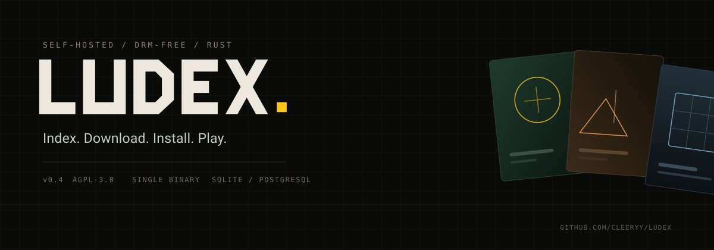
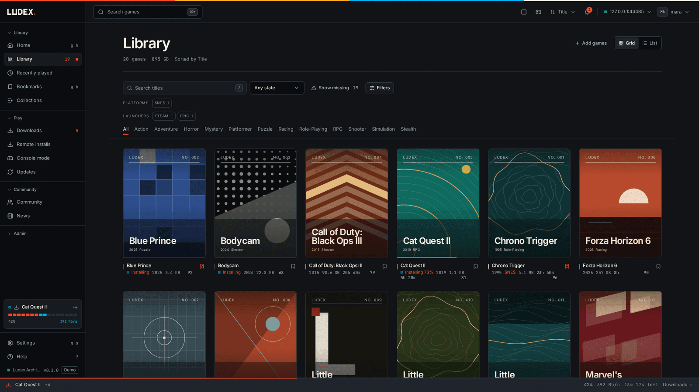
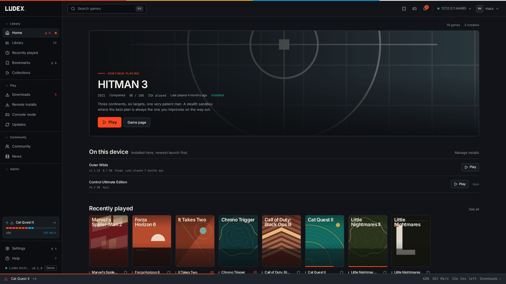
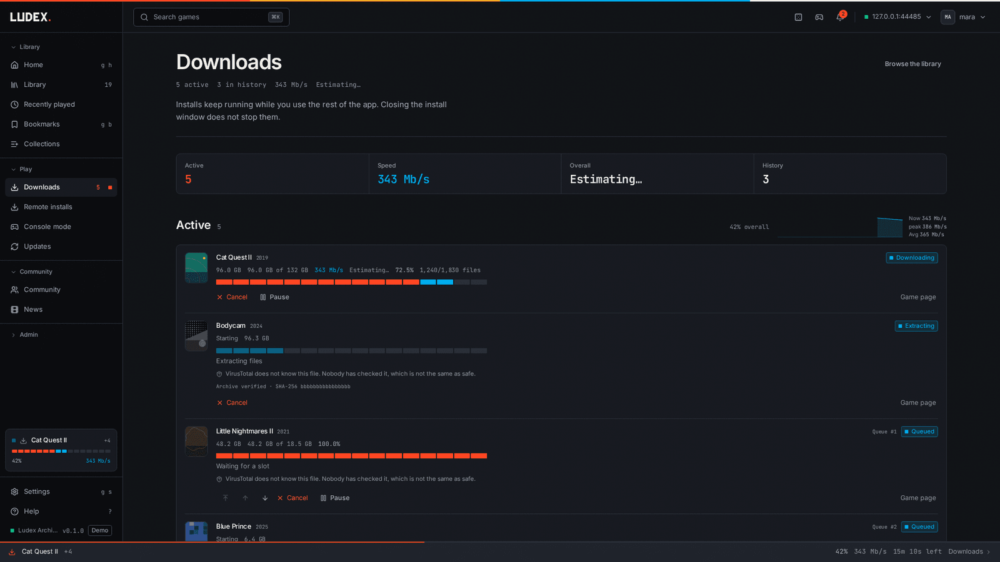
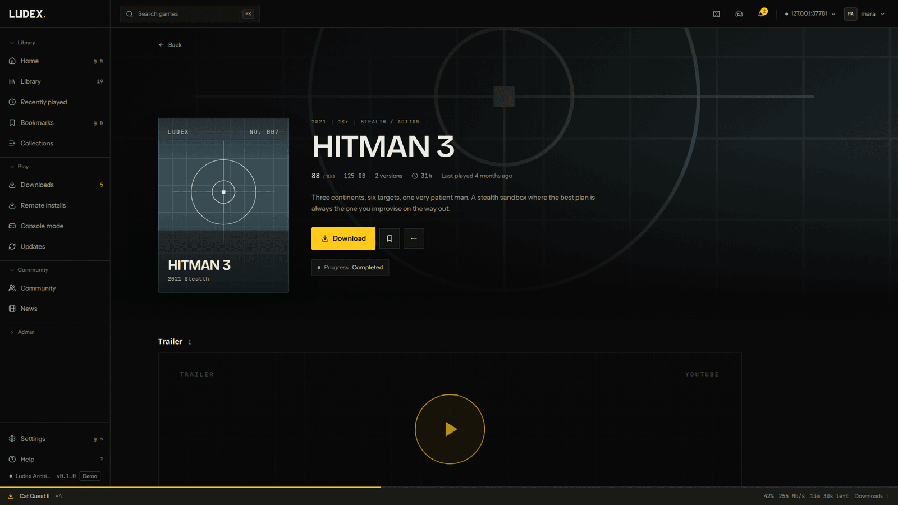
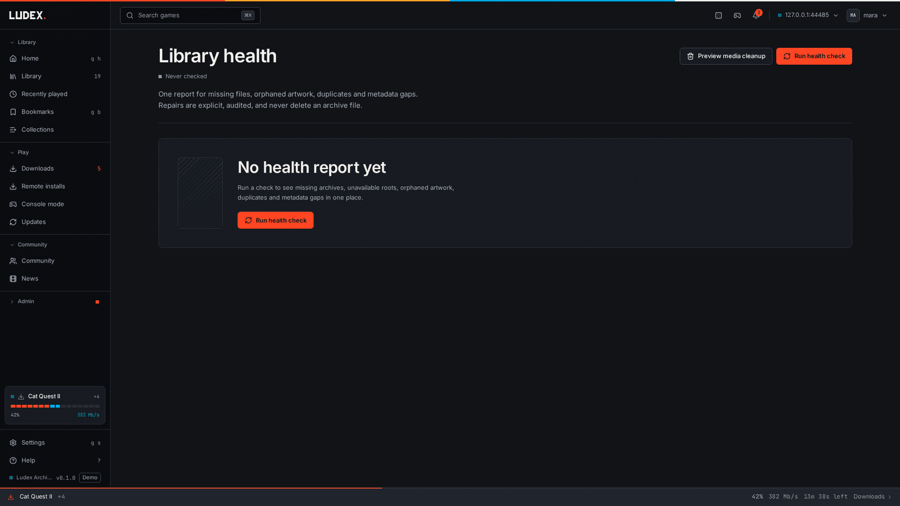
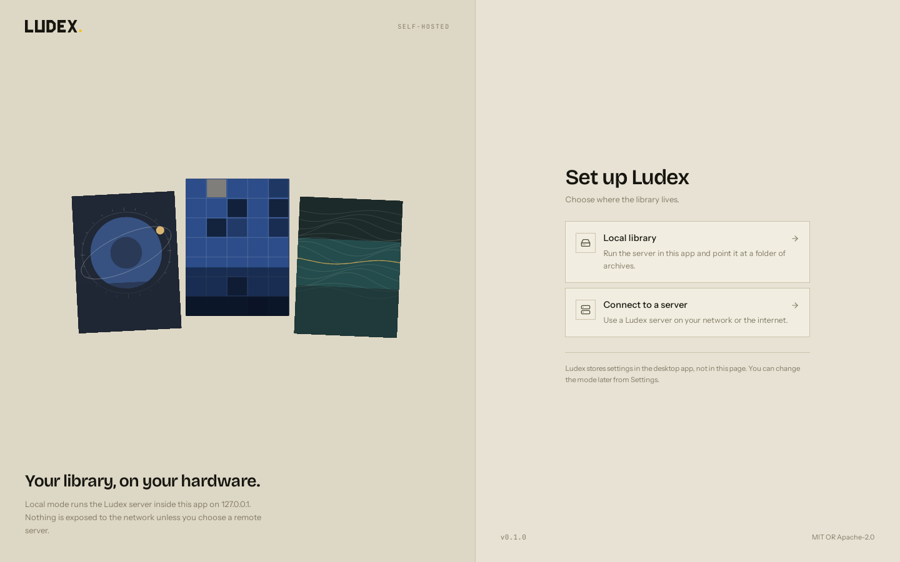
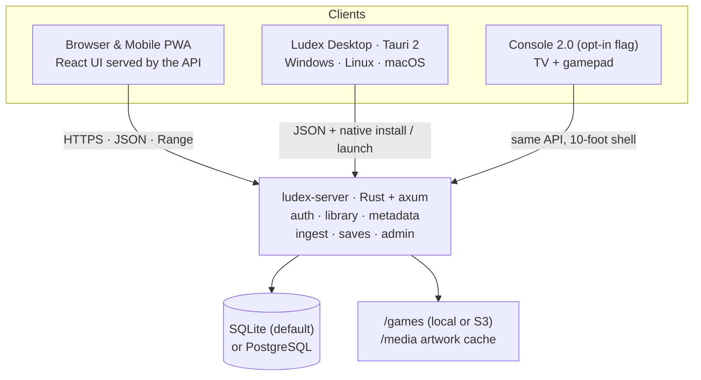

<p align="center">
  
</p>

<h1 align="center">Ludex</h1>

<p align="center">
  <strong>The game library you host yourself.</strong><br>
  Index the DRM-free archives you already own, enrich them with metadata, and install,
  launch and track games from one Rust binary and a Tauri 2 desktop app. SQLite by default,
  no vendor account, no telemetry.
</p>

<p align="center">
  <a href="https://github.com/cleeryy/ludex/actions/workflows/ci.yml"></a>
  <a href="https://github.com/cleeryy/ludex/releases"></a>
  <a href="LICENSE"></a>
  <a href="https://github.com/cleeryy/ludex/pkgs/container/ludex"></a>
  <a href="SECURITY.md"></a>
  <a href="https://github.com/cleeryy/ludex/stargazers"></a>
</p>

<p align="center">
  <picture>
    <source media="(prefers-color-scheme: dark)" srcset="docs/assets/screenshots/design-333/library-speranza-desktop.png">
    <source media="(prefers-color-scheme: light)" srcset="docs/assets/screenshots/design-333/library-bauhaus-desktop.png">
    
  </picture>
</p>

<p align="center">
  <sub>One React UI across browser, desktop, mobile PWA and TV — shown here with the built-in demo catalogue.</sub>
</p>

> **Status: v0.5.2, pre-1.0.** The release badge above is the source of truth. The API and
> database schema can still evolve between minor releases; pin a release tag in production.
> Features behind a device flag or opt-in setting are called out explicitly below. See
> [`docs/FEATURE-PARITY.md`](docs/FEATURE-PARITY.md) for an honest comparison with GameVault
> and [`docs/COMPETITIVE-ROADMAP.md`](docs/COMPETITIVE-ROADMAP.md) for upcoming work.

## What it is, what it is not

| | |
|---|---|
| **Is** a self-hosted server and desktop client for DRM-free game archives (`.zip`, `.7z`, `.rar`, portable `.exe` folders) and ROMs you already own. | **Is not** a store, a torrent index, or a download source. Ludex never bundles, links or distributes games. |
| **Is** one Rust binary with an embedded React UI, SQLite by default (PostgreSQL optional), and three writable directories in Docker. | **Is not** a multi-service Node/Postgres/Redis stack you have to babysit, and requires no vendor account. |
| **Is** a Tauri 2 desktop app that downloads, verifies, extracts, launches (including Proton/Wine and portable Linux bundles) and tracks playtime and cloud saves. | **Is not** a cloud-streaming service: your machine runs your games locally. |
| **Is** AGPL-3.0-or-later with no open-core tier, no telemetry and no paid feature gate. | **Is not** affiliated with GameVault, Steam, GOG, IGDB or any storefront. |

## Why Ludex

- **Your files stay yours.** Your library is a folder of archives on local disk or S3. Artwork is cached locally, nothing phones home, and external services (IGDB, Steam Store, ProtonDB, VirusTotal) are only queried when used or configured.
- **One binary, boring deployment.** `docker compose up -d` with three volumes (`./games`, `./media`, `./data`) is the complete server install. The `embed-web` feature bundles the React UI directly into `ludex-server`.
- **Resilient install transports.** Classic downloads use HTTP `Range` `.part` resume and full-archive SHA-256 verification; **ZIP** stream installs extract entries as they arrive with per-entry resume; and the file-manifest transport serves pre-extracted files in parallel with per-file checksums.
- **One visual system everywhere.** Web, desktop, mobile PWA and Console 2.0 share the ARC × Swiss/Bauhaus × shadcn design system (8 presets plus custom dual-color themes) with progressive disclosure (*Power-user mode*) keeping everyday screens calm by default.
- **Built to be inspected.** Argon2id hashes, path-traversal guards on every file operation, signed desktop updates (minisign), VirusTotal integration, audit logging, Prometheus metrics and a single API contract in [`docs/CONTRACT.md`](docs/CONTRACT.md).

## Feature tour

<table>
  <tr>
    <td width="50%">
      
      <p><strong>Home, focused on playing.</strong> Continue-playing hero with backdrop art, games installed on this machine, collections and recently played titles.</p>
    </td>
    <td width="50%">
      
      <p><strong>A queue you can reason about.</strong> Persisted queue with per-job speed and ETA, pause/resume/cancel, bandwidth limits, disk-space reservations and install history.</p>
    </td>
  </tr>
  <tr>
    <td width="50%">
      
      <p><strong>Console 2.0 — Stage (opt-in flag).</strong> Gamepad- and TV-remote-first 10-foot shell with Stage, Wall and List views. Enabled per device via the <code>console_v2</code> flag (default <strong>off</strong>) and publishable in Sunshine as a single app.</p>
    </td>
    <td width="50%">
      
      <p><strong>Console 2.0 — Wall.</strong> Full library cover wall under shelf chips with 720p/1080p/4K overscan-safe layouts and unified design tokens.</p>
    </td>
  </tr>
  <tr>
    <td width="50%">
      
      <p><strong>Game pages that stay legible.</strong> Versions and rollback, personal notes, cloud saves, achievements, Linux ProtonDB badge, compatibility rules and tiered launch controls.</p>
    </td>
    <td width="50%">
      
      <p><strong>Operations without guesswork.</strong> Library Health Center, games/users/ingest admin, VirusTotal verdicts, backups, audit log and Storage Space Manager.</p>
    </td>
  </tr>
</table>

<p align="center">
  <a href="docs/SCREENSHOTS.md">More screenshots: admin tables, settings, ingest and mobile PWA →</a>
</p>

## Quick start

### Docker (self-hosted server)

```bash
git clone https://github.com/cleeryy/ludex.git && cd ludex
mkdir -p games media data && sudo chown -R 1000:1000 games media data
LUDEX_IMAGE=ghcr.io/cleeryy/ludex:v0.5.2 docker compose up -d
```

Open `http://localhost:8080` to create the first administrator account. Drop game archives into `./games` and run a scan from the UI (or `POST /api/library/scan`). Set `LUDEX_IGDB_CLIENT_ID` and `LUDEX_IGDB_CLIENT_SECRET` in `.env` for IGDB metadata; without them Ludex falls back to the Steam Store and then filenames.

Images live at `ghcr.io/cleeryy/ludex` — pin a release tag from [Releases](https://github.com/cleeryy/ludex/releases) in production (`latest` tracks the newest stable tag). Reverse proxies, systemd, permissions and bare-binary installs are documented in [`docs/DEPLOY.md`](docs/DEPLOY.md).

### Desktop app

| Platform | Installer |
|---|---|
| Windows x64 | `Ludex_*_x64-setup.exe` (per-user NSIS) from [Releases](https://github.com/cleeryy/ludex/releases). Not code-signed yet: SmartScreen may ask for *More info → Run anyway*. |
| Linux x64 | AppImage (`chmod +x Ludex_*.AppImage`, requires WebKitGTK 4.1) or `sudo apt install ./ludex_*.deb`. |
| macOS | Experimental/unsigned; building from source is currently the supported path. |

Every Ludex server also serves a public `#/download` page that detects the visitor's OS and links directly to the matching release installers and SHA-256 digests (`GET /api/desktop/download`).

On first launch, choose one of two modes:

1. **Local library** — select a games folder; the desktop starts the embedded `ludex-server` on `127.0.0.1` with a local SQLite database, no login and no Docker.
2. **Connect to a server** — enter your server URL and sign in (password, TOTP 2FA or OIDC SSO).

<p align="center">
  
</p>

## How it works



- `crates/ludex-core` — domain types, filename parser, archive extraction and executable discovery (no network, no database).
- `crates/ludex-server` — axum API, scanner, metadata providers, ingest queue, embedded web UI and local-mode entry point.
- `apps/web` — React 19 + Vite + Tailwind UI shared across browser, desktop, mobile PWA and Console 2.0.
- `apps/desktop` — Tauri 2 shell with native download/extract, Proton/Wine/Gamescope/portable-bundle launch, cloud saves and playtime tracking.

### Install transports

| Transport | Formats | Resume unit | Default |
|---|---|---|---|
| **Classic** | `.zip`, `.7z`, `.rar`, portable `.exe` | Archive byte offset (`Range` + `.part`) | Fallback for all formats |
| **Stream** | **`.zip` only** (7z/RAR fall back to classic) | Archive entry (CRC-32 verified) | **On by default** |
| **File manifest** | `.zip`, `.7z`, `.rar` (extracted once on server) | Individual file (SHA-256 verified) | **On in desktop local mode**; opt-in on self-hosted servers (`LUDEX_EXTRACTED_CACHE=1`) |

Full details and tuning live in [`docs/DOWNLOADS.md`](docs/DOWNLOADS.md).

## Feature matrix

| Area | Status | Notes |
|---|---|---|
| Design system (#333) | Shipped | 8 built-in themes + custom dual-color picker, unified Power-user mode |
| Library UX | Shipped | Saved filter presets, *Surprise me* picker, personal notes, smart & manual collections |
| Desktop installs & storage | Shipped | Multi-location roots, Storage Space Manager, GameVault folder adoption, launcher imports |
| Linux gaming | Shipped | Proton/GE-Proton/UMU/Wine, Gamescope, ProtonDB badge, compatibility rules, portable `run.sh`/`install.sh` bundles |
| Cloud saves | Shipped | Manual browser snapshots + automatic desktop post-session sync (Ludusavi discovery) |
| Remote installs (mobile PWA) | Shipped | Queue installs from a phone to online desktop devices on the same account |
| Console 2.0 (10-foot TV UI) | Behind flag | Stage/Wall/List views gated by device-local `console_v2` flag (default **off**) |
| Server backends | Shipped | SQLite default, PostgreSQL optional; local disk default, S3-compatible storage optional |
| Security & integrations | Shipped | Argon2id, TOTP 2FA, OIDC SSO, API keys, signed webhooks, VirusTotal scanning, audit log |

## Configuration

Server configuration uses environment variables read at startup (see [`docs/DEPLOY.md`](docs/DEPLOY.md) and [`.env.example`](.env.example) for the complete reference):

| Variable | Default | Purpose |
|---|---|---|
| `LUDEX_BIND` | `0.0.0.0:8080` | Bind address (use `127.0.0.1:8080` behind a reverse proxy). |
| `LUDEX_DATA_DIR` | `/data` | SQLite DB, JWT secret and cloud save snapshots. **Back this up.** |
| `LUDEX_GAMES_DIR` | `/games` | Archive library root, scanned recursively. |
| `LUDEX_MEDIA_DIR` | `/media` | Cached covers, backdrops and screenshots (rebuildable). |
| `LUDEX_DATABASE_URL` | SQLite in `LUDEX_DATA_DIR` | Set `postgres://…` to use PostgreSQL ([`docs/POSTGRES.md`](docs/POSTGRES.md)). |
| `LUDEX_STORAGE_BACKEND` | `local` | `local` or `s3` for archive storage ([`docs/STORAGE.md`](docs/STORAGE.md)). |
| `LUDEX_EXTRACTED_CACHE` | `0` (`1` in desktop local mode) | Opt-in server-side extracted file-manifest cache ([`docs/DOWNLOADS.md`](docs/DOWNLOADS.md)). |
| `LUDEX_IGDB_CLIENT_ID` / `_SECRET` | unset | IGDB metadata credentials; Steam Store is the fallback. |
| `LUDEX_INGEST_ALLOW_PRIVATE` | `false` | Allow URL ingest targeting private/LAN addresses. |
| `LUDEX_SCAN_INTERVAL_SECONDS` | `300` | Periodic scan cadence (`0` disables). |
| `LUDEX_BACKUP_DIR` | `{DATA}/backups` | Output folder for admin backups and `ludex-backup`. |
| `LUDEX_METRICS_TOKEN` | unset | Optional bearer token protecting `/metrics`. |

## Security and data ownership

- Argon2id passwords, HS256 JWTs, optional TOTP 2FA with recovery codes, OIDC SSO, invitation-only registration and revocable per-device sessions.
- Path-traversal guards on every archive, save and media path; format detection from file headers; full SHA-256 verification before install; minisign-verified desktop updates.
- Container runs non-root (`1000:1000`) with `no-new-privileges:true` and a built-in `ludex-server healthcheck` subcommand.
- Report security issues privately via [`SECURITY.md`](SECURITY.md); see [`docs/SECURITY.md`](docs/SECURITY.md) for the threat model.

## Platform and format support

| Target | Support |
|---|---|
| Server | Linux x86_64 binary, Docker (`ghcr.io/cleeryy/ludex`), or embedded in desktop local mode |
| Desktop client | Windows x64 (NSIS), Linux x64 (AppImage, `.deb`), macOS (experimental/build from source) |
| Web / Mobile | Modern desktop browsers and mobile PWA |
| Archive & game formats | `.zip`, `.7z`, `.rar`, portable `.exe` folders, plus ROM collections via configured emulators ([`docs/EMULATORS.md`](docs/EMULATORS.md)) |

## Development and CI

Prerequisites: Rust stable, Node 22, pnpm 9, and the [Tauri 2 prerequisites](https://v2.tauri.app/start/prerequisites/) for desktop builds.

```bash
pnpm install                                             # workspace JS dependencies
scripts/dev.sh                                           # API (:8080) + Vite (:5173) with .dev/
cargo test --workspace --all-targets                     # Rust unit & integration tests
pnpm --filter @ludex/web test && pnpm --filter @ludex/web build
scripts/e2e.sh                                           # full Playwright E2E harness
scripts/screenshots.sh                                   # regenerate demo screenshots (#265)
node scripts/check-assets.mjs                            # verify docs links & image budgets
```

CI (`.github/workflows/ci.yml`) runs `rustfmt`, `clippy -D warnings`, Rust & PostgreSQL tests, web build/tests/i18n parity, desktop checks across Linux/Windows/macOS, Docker build, CodeQL, Trivy and the Playwright E2E gate.

## Documentation

| Topic | Document |
|---|---|
| API and Tauri contract | [`docs/CONTRACT.md`](docs/CONTRACT.md) |
| Deployment (Docker, reverse proxy, systemd, bare binary) | [`docs/DEPLOY.md`](docs/DEPLOY.md) |
| Downloads, transports, resume and queues | [`docs/DOWNLOADS.md`](docs/DOWNLOADS.md) |
| Architecture and network design | [`docs/ARCHITECTURE.md`](docs/ARCHITECTURE.md), [`docs/NETWORK-ARCHITECTURE.md`](docs/NETWORK-ARCHITECTURE.md) |
| PostgreSQL, S3 storage and backups | [`docs/POSTGRES.md`](docs/POSTGRES.md), [`docs/STORAGE.md`](docs/STORAGE.md), [`docs/BACKUP.md`](docs/BACKUP.md) |
| Auth, OIDC SSO, API keys, webhooks and security | [`docs/OIDC.md`](docs/OIDC.md), [`docs/INTEGRATIONS.md`](docs/INTEGRATIONS.md), [`docs/SECURITY.md`](docs/SECURITY.md) |
| Saves, achievements, emulators, Linux gaming & Proton | [`docs/SAVES.md`](docs/SAVES.md), [`docs/ACHIEVEMENTS.md`](docs/ACHIEVEMENTS.md), [`docs/EMULATORS.md`](docs/EMULATORS.md), [`docs/LINUX-GAMING.md`](docs/LINUX-GAMING.md) |
| Settings tiers, compatibility rules and remote access | [`docs/SETTINGS.md`](docs/SETTINGS.md), [`docs/COMPAT-RULES.md`](docs/COMPAT-RULES.md), [`docs/REMOTE-ACCESS.md`](docs/REMOTE-ACCESS.md) |
| i18n, screenshots and UX/UI audit | [`docs/I18N.md`](docs/I18N.md), [`docs/SCREENSHOTS.md`](docs/SCREENSHOTS.md), [`docs/UX-UI-AUDIT-2026-11.md`](docs/UX-UI-AUDIT-2026-11.md) |
| GameVault comparison, migration and roadmap | [`docs/FEATURE-PARITY.md`](docs/FEATURE-PARITY.md), [`docs/MIGRATION.md`](docs/MIGRATION.md), [`docs/COMPETITIVE-ROADMAP.md`](docs/COMPETITIVE-ROADMAP.md) |
| Releasing, CI, GitOps and repository settings | [`docs/RELEASING.md`](docs/RELEASING.md), [`docs/CI.md`](docs/CI.md), [`docs/GITOPS.md`](docs/GITOPS.md), [`docs/REPO.md`](docs/REPO.md) |

## Roadmap

Genuinely unshipped work planned after v0.5.2 (see [`docs/COMPETITIVE-ROADMAP.md`](docs/COMPETITIVE-ROADMAP.md) for the broader roadmap):

- **Console 2.0 promotion to default** — real Windows 11 + Sunshine/Moonlight + TV + physical gamepad sign-off (#270, #306).
- **GameVault database import** — pointing Ludex at a `/games` volume and adopting installed folders already works ([`docs/MIGRATION.md`](docs/MIGRATION.md)); importing users, custom metadata overrides and progress from GameVault's PostgreSQL DB is still planned.
- **Passkeys (WebAuthn)** — TOTP 2FA and OIDC SSO are shipped today.
- **Documentation & project site** — static landing page and searchable Fumadocs documentation site on GitHub Pages (#367).
- **Server-side cloud streaming** remains an explicit non-goal: games run locally on your machine.

Release notes for every tag live in [`CHANGELOG.md`](CHANGELOG.md).

## Contributing and license

Contributions are welcome — see [`CONTRIBUTING.md`](CONTRIBUTING.md) for branch conventions, Conventional Commits, required CI checks and contract-first API changes. Report vulnerabilities privately through [`SECURITY.md`](SECURITY.md).

Ludex is licensed under **AGPL-3.0-or-later** ([`LICENSE`](LICENSE)). v0.1.0 was released under MIT OR Apache-2.0; that historical grant is not revoked. Ludex is an independent clean-room implementation and is not affiliated with GameVault, Steam, GOG, IGDB or any storefront.
