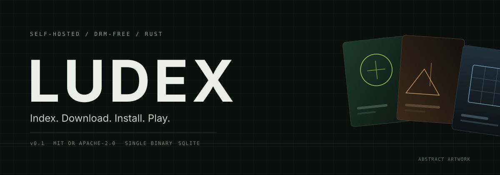
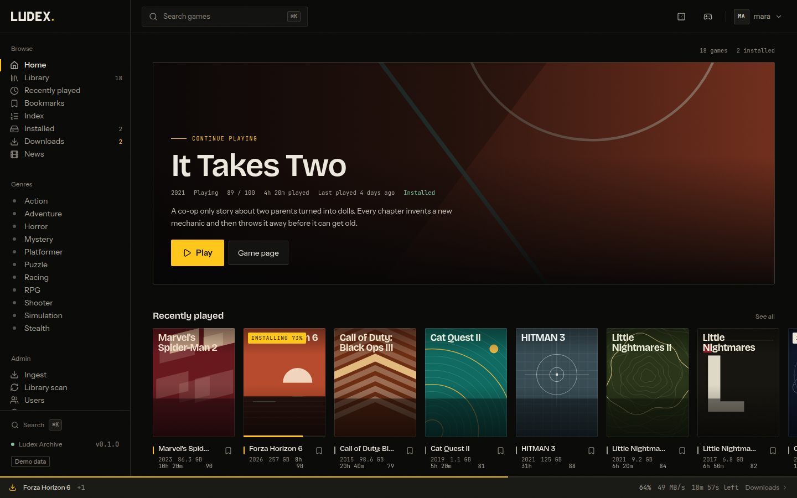
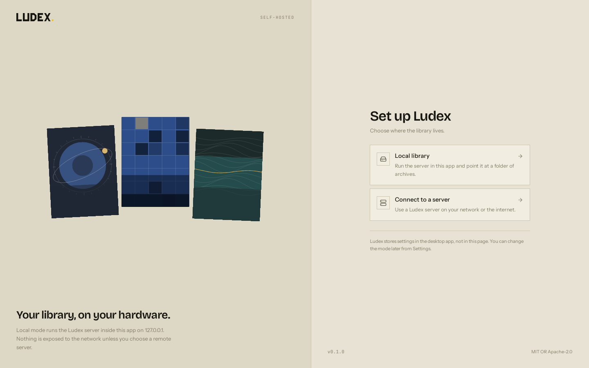

<p align="center">
  
</p>

<h1 align="center">LUDEX</h1>

<p align="center">
  <strong>Your DRM-free game library, self-hosted.</strong><br>
  A single Rust binary that indexes your archives, enriches metadata, and streams
  installs to a desktop app that unpacks and launches your games.
</p>

<p align="center">
  <a href="https://github.com/cleeryy/ludex/actions/workflows/ci.yml"></a>
  <a href="https://github.com/cleeryy/ludex/releases"></a>
  <a href="#license"></a>
  <a href="https://github.com/cleeryy/ludex/pkgs/container/ludex"></a>
</p>

> **Status: v0.2.0 — current release line.** The API and database schema may still change.
> Features are marked with the release that introduced them; anything marked
> *roadmap* is not in v0.2. Bug reports and migration feedback are welcome.

Ludex is a clean-room, AGPL-3.0 licensed alternative to
[GameVault](https://gamevault.app). It is not affiliated with or endorsed by
GameVault, and contains no GameVault code.

<p align="center">
  
  <br>
  <sub>The Ludex library (demo data). The same UI runs in the browser and the desktop app.</sub>
</p>

## Why another game library?

GameVault is source-available, not open source, and its server is a TypeScript
application backed by PostgreSQL. Ludex takes a different route:

- **Open source, for real.** AGPL-3.0, no open-core tier, no paid
  feature gate.
- **One binary.** Rust + axum + SQLite. No Node runtime, no PostgreSQL,
  no Redis. `docker run` with three volumes is the whole deployment.
- **Fast where it matters.** Scanning is a `stat` + extension walk, metadata is
  fetched in the background, and downloads use HTTP Range so a dropped
  connection resumes instead of restarting.
- **The same UI everywhere.** The web app and the Tauri desktop app share one
  React codebase; native install/launch/playtime are detected at runtime.
- **Your files stay yours.** The library is a folder of `.zip`, `.rar`, `.7z`
  and portable `.exe` files. Nothing is sent to a third party. No telemetry.
- **A migration path.** Point Ludex at an existing GameVault `/games` volume and
  scan it; metadata and progress import is on the roadmap.

## Features

| Feature | Status |
|---|---|
| Library scan of `.zip`, `.rar`, `.7z`, portable `.exe` | v0.1 |
| Filename parser: title, year, version, edition tags | v0.1 |
| Metadata from IGDB, Steam Store fallback, filename last | v0.1 |
| Manual metadata editing (admin/editor) | v0.1 |
| Covers, backgrounds, screenshots cached locally | v0.1 |
| Search, genre/state/bookmark filters, sorting, pagination | v0.1 |
| Bookmarks, progress states, playtime, last played | v0.1 |
| Multiple versions per game | v0.1 |
| Download with HTTP Range, resumable, short-lived tickets | v0.1 |
| Ingest queue: URL download only (no web upload in v0.1), resume, magic-byte detection, verify | v0.1 |
| Downloads manager: queue/history, background installs, cancel/resume | v0.2 |
| Custom install and download folders | v0.2 |
| Stream install for ZIP and 7z (no archive retained) | v0.2 |
| Big Picture mode (keyboard/gamepad) | v0.2 |
| Higher-resolution IGDB covers/backgrounds | v0.2 |
| SSO OIDC (Authentik/Keycloak) | v0.2 |
| Web UI served by the server | v0.1 |
| Users and roles (`admin`, `editor`, `user`) | v0.1 |
| News posts | v0.1 |
| Desktop app: Windows and Linux, install/launch/playtime | v0.1 (beta) |
| Local mode: desktop runs the server in-process | v0.1 |
| Docker image and Compose example | v0.1 |
| Scan an existing GameVault archive volume | v0.1 |
| GameVault metadata/progress import | roadmap |
| Share links, collections, community view | roadmap |
| Cloud saves via Ludusavi | roadmap |
| Discord Rich Presence, Steam, Playnite integration | roadmap |
| Gamepad navigation, tray icon, auto-updater | roadmap |
| Themes, translations, multiple profiles | roadmap |
| macOS desktop build | experimental, unsigned |

The API is documented in [`docs/CONTRACT.md`](docs/CONTRACT.md), the design in
[`docs/ARCHITECTURE.md`](docs/ARCHITECTURE.md), and the honest GameVault
comparison in [`docs/FEATURE-PARITY.md`](docs/FEATURE-PARITY.md).

## Quick start (Docker)

```bash
git clone https://github.com/cleeryy/ludex.git
cd ludex

mkdir -p games media data
sudo chown -R 1000:1000 games media data   # the container runs as uid/gid 1000

cp .env.example .env
# optional: set LUDEX_IGDB_CLIENT_ID and LUDEX_IGDB_CLIENT_SECRET in .env

docker compose up -d
```

Open <http://localhost:8080>. The first-run screen creates the admin account.
Drop archives into `./games`, then trigger a scan from the UI or with:

```bash
curl -X POST http://localhost:8080/api/library/scan \
  -H "authorization: Bearer <token>"
```

Useful commands:

```bash
docker compose logs -f ludex   # logs
docker compose pull && docker compose up -d   # upgrade
docker compose down            # stop (volumes stay on disk)
```

To build the image locally instead of pulling it:

```bash
docker compose up -d --build
```

The image is published as `ghcr.io/cleeryy/ludex`. Pin a version in production
(`ghcr.io/cleeryy/ludex:v0.2.0`) rather than tracking `latest`.

## Desktop app

Download the latest installer from
[Releases](https://github.com/cleeryy/ludex/releases):

- **Windows x64** — NSIS installer (`Ludex_*_x64-setup.exe`). The build is not
  code-signed yet, so SmartScreen may ask for *More info → Run anyway*.
- **Linux x64** — AppImage (`chmod +x Ludex_*.AppImage`) or Debian package
  (`sudo apt install ./ludex_*.deb`). The AppImage needs WebKitGTK 4.1 from your
  distribution.
- **macOS** — experimental, unsigned; building from source is the supported path
  for now.

On first launch the wizard offers two modes:

1. **Local library** — pick a games folder. The desktop starts the same server
   in-process on `127.0.0.1` with a private SQLite database and an
   auto-provisioned local admin token, so there is no login screen. This is the
   zero-setup path for a single machine.
2. **Connect to a server** — enter the URL of a Ludex server (Docker, NAS, VPS)
   and sign in. Installs download from that server, resume on failure, extract
   with zip/7z/rar support, detect the main executable, launch the game, and
   report playtime back to the server.

<p align="center">
  
  <br>
  <sub>The desktop first-run wizard: local library or a remote server.</sub>
</p>

## How it works

```
┌────────────────────────────┐      ┌──────────────────────────────┐
│ Browser                    │      │ Ludex Desktop (Tauri 2)      │
│ React UI served by the API │      │ Windows · Linux · macOS*     │
└─────────────┬──────────────┘      └──────────────┬───────────────┘
              │ HTTPS · JSON · Range               │ JSON + native commands
              └─────────────────┬──────────────────┘
                                ▼
                 ┌────────────────────────────────┐
                 │ ludex-server (Rust + axum)     │
                 │ auth · library · metadata      │
                 │ ingest · streaming · news      │
                 └───────┬──────────┬─────────────┘
                         │          │
                 SQLite  │          │ archives (read/write)
                         ▼          ▼
                      /data      /games          /media (artwork cache)
```

- `crates/ludex-core` — domain types, filename parser, archive reader/extractor,
  executable discovery. No network, no database.
- `crates/ludex-server` — axum + SQLite API, scanner, metadata providers, ingest
  queue, static web UI, and an embeddable `start()` API for desktop local mode.
- `apps/web` — React 19 + Vite + Tailwind, shared by browser and Tauri.
- `apps/desktop` — Tauri 2 shell and native install/launch/playtime commands.

## Configuration

Environment variables are read at startup. Docker defaults are shown; a bare
binary defaults to the current directory for the three paths.

| Variable | Default | Description |
|---|---|---|
| `LUDEX_BIND` | `0.0.0.0:8080` | Listen address. Use `127.0.0.1:8080` behind a reverse proxy. |
| `LUDEX_DATA_DIR` | `/data` | SQLite database and generated JWT secret. **Back this up.** |
| `LUDEX_GAMES_DIR` | `/games` | Archive library. Scanned recursively (depth 3). |
| `LUDEX_MEDIA_DIR` | `/media` | Cached covers, backgrounds and screenshots. Rebuildable. |
| `LUDEX_SERVER_NAME` | `Ludex` | Display name in the UI and API. |
| `LUDEX_JWT_SECRET` | generated | HS256 signing secret. Set only to survive a wiped data dir. 32+ random bytes. |
| `LUDEX_IGDB_CLIENT_ID` | unset | Twitch application client ID for IGDB metadata. |
| `LUDEX_IGDB_CLIENT_SECRET` | unset | Twitch application client secret. Server-side only. |
| `LUDEX_INGEST_ALLOW_PRIVATE` | `false` | Allow ingest URLs pointing at private/link-local addresses. |
| `LUDEX_SCAN_INTERVAL_SECONDS` | `300` | Periodic scan interval; `0` disables it. |
| `LUDEX_DATABASE_URL` | `sqlite://$LUDEX_DATA_DIR/ludex.db?mode=rwc` | Advanced: override the SQLite connection string. |
| `LUDEX_ADMIN_USERNAME` / `LUDEX_ADMIN_PASSWORD` | unset | Optional first-run admin bootstrap, only while zero users exist. Prefer the UI. |
| `LUDEX_WEB_DIR` | unset | Serve the web UI from a directory instead of the embedded build. |
| `LUDEX_LOCAL_MODE` | `false` | Desktop-only embedded mode; do not set on a server. |
| `RUST_LOG` | `ludex_server=info,tower_http=warn` | Log filter (`tracing` `EnvFilter` syntax). |

See [`.env.example`](.env.example) for a copy-paste template and
[`docs/DEPLOY.md`](docs/DEPLOY.md) for reverse proxy, permissions, backups and
binary/systemd deployment.

## Development

Prerequisites: Rust stable, Node 22, pnpm 9. For the desktop app, the
[Tauri 2 system dependencies](https://v2.tauri.app/start/prerequisites/) for
your OS (WebKitGTK 4.1 on Linux, WebView2 on Windows).

```bash
pnpm install                 # web + desktop JS dependencies
pnpm dev                     # Vite dev server (proxies /api)
cargo run -p ludex-server    # API + scanner on 127.0.0.1:8080
scripts/dev.sh               # both, with .dev/{data,games,media}
scripts/smoke.sh             # end-to-end API smoke test

pnpm build                   # build the web UI
cargo build --release -p ludex-server --features embed-web
pnpm desktop:dev             # Tauri dev shell
pnpm desktop:dist            # desktop installers
```

Run the checks CI runs:

```bash
cargo fmt --all -- --check
cargo clippy --workspace --all-targets -- -D warnings
cargo test --workspace --all-targets
pnpm --filter @ludex/web build
pnpm --filter @ludex/web exec tsc --noEmit
```

The server can serve a development build without embedding by running Vite
separately. `embed-web` compiles `apps/web/dist` into the binary for a single
deployable artifact.

## Migrating from GameVault

Ludex can scan a GameVault `/games` volume as-is. Run it on a second port with
the volume mounted read-only, verify the archive count, then cut over. Metadata
and progress import is **not** in v0.1; export the GameVault PostgreSQL database
now so a future importer can use it. Full procedure, including warnings about
two writers on one volume: [`docs/MIGRATION.md`](docs/MIGRATION.md).

## Security

- Argon2id password hashes, HS256 JWTs, first-run setup only while zero users
  exist.
- All file operations are path-traversal guarded; ingest filenames are sanitized.
- Media endpoints are public (non-sensitive cached artwork); everything else
  requires authentication.
- The container runs as uid/gid 1000 and drops unnecessary privileges.
- No telemetry, no phone-home, no external account required. IGDB and Steam are
  only contacted when you configure/trigger metadata enrichment.

Put Ludex behind HTTPS (Caddy, nginx, Traefik) before exposing it to the
internet. Do not expose the data directory or the SQLite file.

## License and clean-room statement

Ludex v0.2.0 and later is licensed under the **GNU Affero General Public License
v3.0 or later** (AGPL-3.0-or-later). See [`LICENSE`](LICENSE). v0.1.0 was
released under MIT OR Apache-2.0; that historical grant is not revoked.

Ludex is an independent clean-room implementation. No GameVault source code was
copied, translated or vendored. GameVault is a trademark of its respective
owners; references to it are descriptive only. Ludex is not affiliated with,
sponsored by, or endorsed by GameVault or Phalcode.

Ludex does not circumvent DRM, does not bundle games, and does not provide
storefront or piracy features. You are responsible for the files you index.
