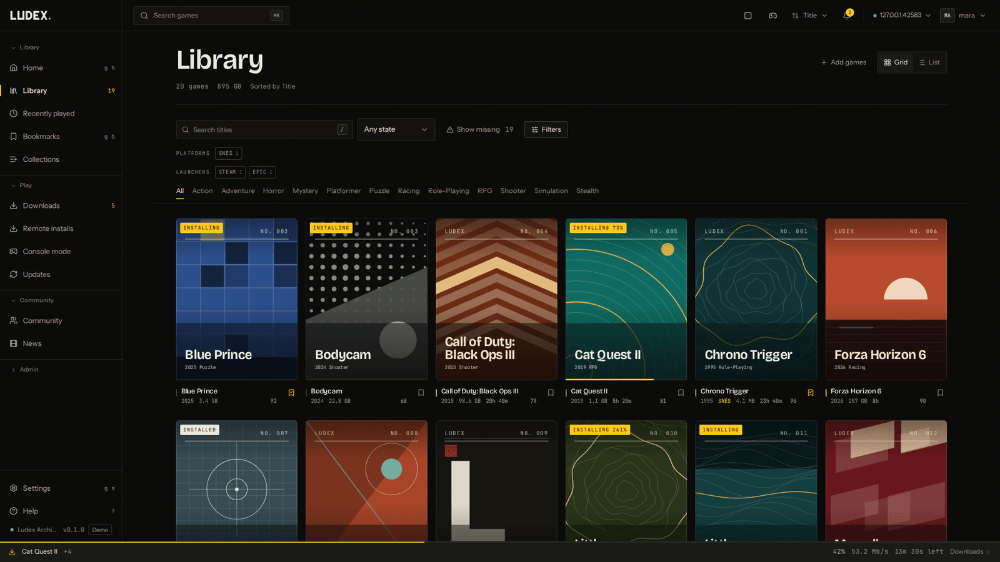
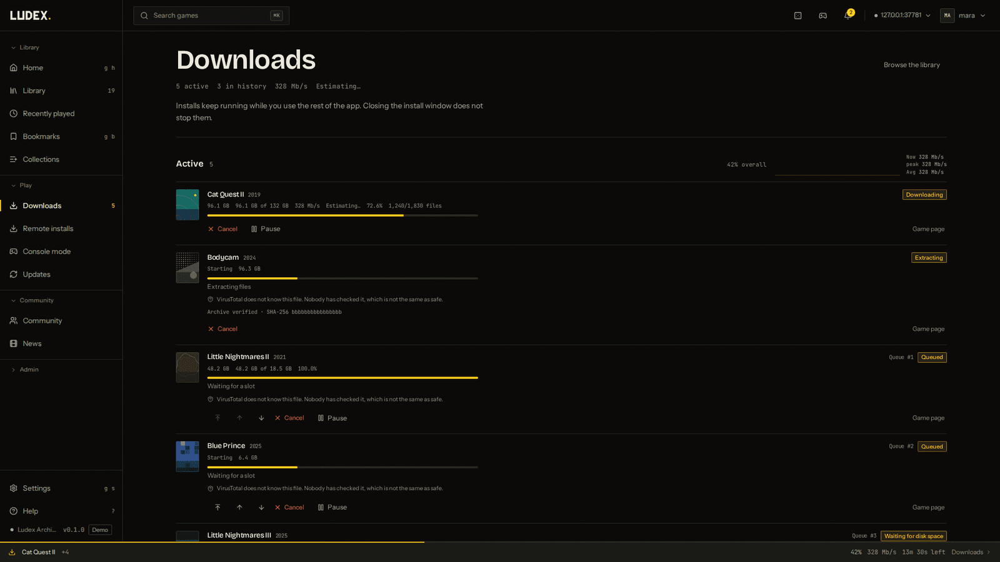
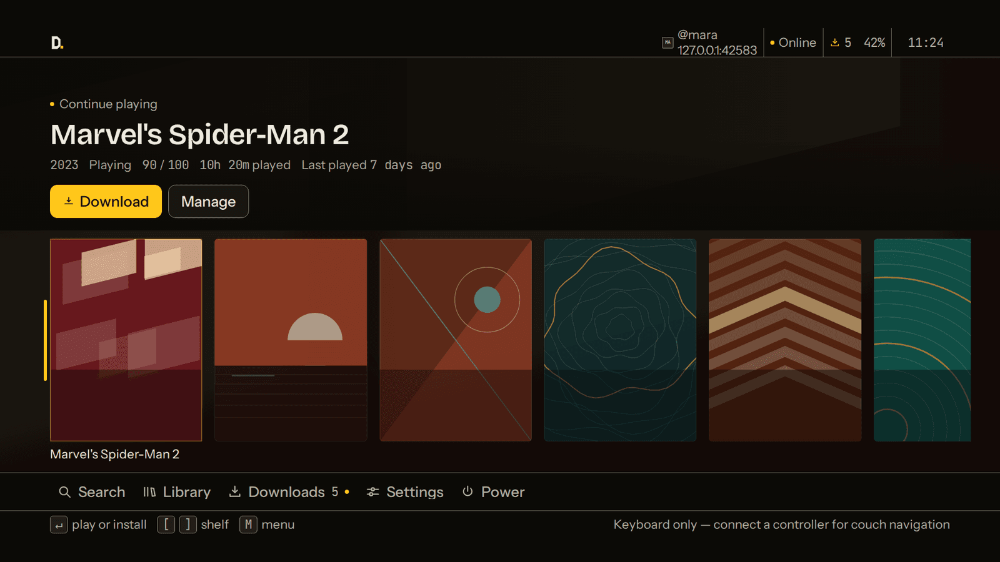
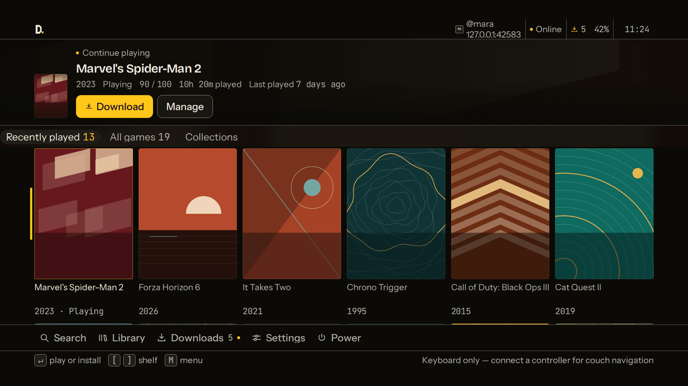
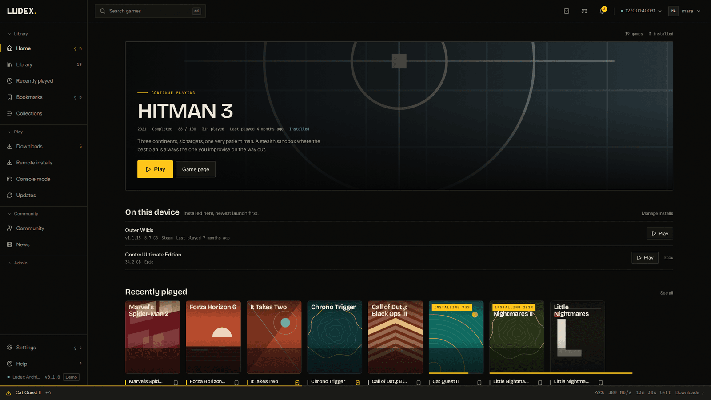
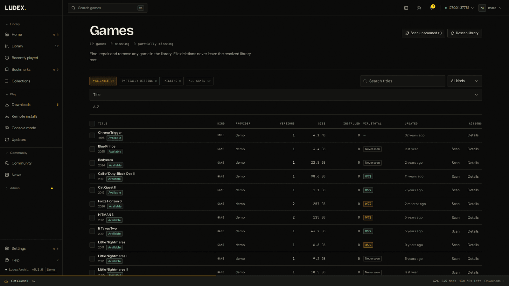
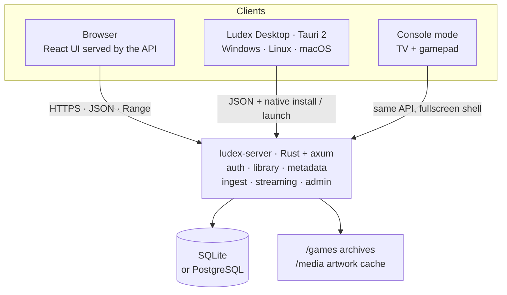

<p align="center">
  
</p>

<h1 align="center">Ludex</h1>

<p align="center">
  <strong>The game library you host yourself.</strong><br>
  Index the archives you already own, enrich them with metadata, and stream installs to a
  desktop app that unpacks, launches and tracks playtime. One Rust binary, SQLite by default,
  no vendor account.
</p>

<p align="center">
  <a href="https://github.com/cleeryy/ludex/actions/workflows/ci.yml"></a>
  <a href="https://github.com/cleeryy/ludex/releases"></a>
  <a href="LICENSE"></a>
  <a href="https://github.com/cleeryy/ludex/pkgs/container/ludex"></a>
  <a href="SECURITY.md"></a>
  <a href="https://github.com/cleeryy/ludex/stargazers"></a>
</p>

<p align="center">
  <picture>
    <source media="(prefers-color-scheme: dark)" srcset="docs/assets/screenshots/readme/library-dark.png">
    <source media="(prefers-color-scheme: light)" srcset="docs/assets/screenshots/readme/library-light.png">
    
  </picture>
</p>

<p align="center">
  <sub>The same React UI runs in the browser, in the desktop app and on a TV — here with the built-in demo library.</sub>
</p>

> **Status: v0.4.15, pre-1.0.** The release badge above is the source of truth. The API and
> database schema can still change between minor releases; pin an image tag in production.
> Every feature below is shipped —
> the road to the next release lives in [Roadmap](#roadmap), and the honest comparison with
> GameVault is in [`docs/FEATURE-PARITY.md`](docs/FEATURE-PARITY.md).

## What it is, what it is not

| | |
|---|---|
| **Is** a self-hosted server for DRM-free game archives you already have: it scans `.zip`, `.rar`, `.7z` and portable `.exe` folders, fetches metadata, serves a web UI, and hands installs to a desktop client. | **Is not** a store, a torrent index, or a download source. Ludex never bundles, links or fetches games for you. |
| **Is** one Rust binary with an embedded web build, a SQLite database by default (PostgreSQL optional), and three volumes in Docker. | **Is not** a Node/Postgres/Redis stack you have to babysit, and it does not need an external account. |
| **Is** a Tauri 2 desktop app that unpacks archives, detects the main executable, launches the game, and reports playtime back to the server. | **Is not** a streaming service: games run on your machine, not on the server. |
| **Is** AGPL-3.0, with no open-core tier, no telemetry and no paid feature gate. | **Is not** affiliated with GameVault, Steam, IGDB or any storefront. |

## Why Ludex

- **Your files stay yours.** The library is a folder of archives. Covers and backgrounds are
  cached locally, nothing is uploaded, and the only outbound calls are the metadata providers
  you configure. Diagnostics are opt-in, local and redacted before anything is sent.
- **One binary, boring deployment.** `docker compose up -d` with three volumes is the whole
  install. `embed-web` compiles the React UI into the server, so there is no second process
  and no reverse-proxy rewrite to get right.
- **Downloads that survive reality.** Classic installs use HTTP Range with `.part` resume,
  stall detection and bounded reconnect; stream installs extract ZIP/7z while downloading and
  fall back to classic when a format cannot stream. The queue is persisted, reorderable and
  keeps going when you close the window.
- **The same UI everywhere.** Web, desktop and 10-foot console mode share one React codebase;
  a phone gets a PWA with a remote-install queue, a TV gets a gamepad-first shell.
- **Built to be inspected.** Argon2id hashes, path-traversal guards on every file operation,
  full-archive SHA-256 verification before install, an audit log, API keys, signed webhooks,
  and a documented API contract in [`docs/CONTRACT.md`](docs/CONTRACT.md).

## Feature tour

<table>
  <tr>
    <td width="50%">
      
      <p><strong>Game pages that hold the details.</strong> Versions and rollback, install
      location, saves, achievements, launch options and the archive's real SHA-256 — in one
      scrolling page.</p>
    </td>
    <td width="50%">
      
      <p><strong>A queue you can reason about.</strong> One active download, the rest queued
      with positions, per-job speed and ETA, pause/resume/cancel, disk-space reservations and
      a history row per game.</p>
    </td>
  </tr>
  <tr>
    <td width="50%">
      
      <p><strong>Console, Stage.</strong> The Cabinet room: one lit game on the stage, a rail
      of five and a half covers, and a band of five destinations. Controller-first, with its
      own sound language; Sunshine can publish it as a single app.</p>
    </td>
    <td width="50%">
      
      <p><strong>Console, Wall.</strong> The same library as a wall of covers under shelf
      chips, with the stage header keeping the primary action in reach. Rooms and eight knobs
      change the material; nothing asks you to confirm.</p>
    </td>
  </tr>
</table>

<table>
  <tr>
    <td width="50%">
      
      <p><strong>Home, not a dashboard.</strong> What you played last, what is installed here,
      and a shelf of recently played covers. Nothing else competes for attention.</p>
    </td>
    <td width="50%">
      
      <p><strong>Admin that answers questions.</strong> Every game with availability,
      versions, size, installs and VirusTotal verdicts, plus the Library Health Center,
      backups, observability and an audit log.</p>
    </td>
  </tr>
</table>

<p align="center">
  <a href="docs/SCREENSHOTS.md">More screenshots: admin, settings, ingest and the mobile PWA →</a>
</p>

## Quick start

### Docker (server, 3 commands)

```bash
git clone https://github.com/cleeryy/ludex.git && cd ludex
mkdir -p games media data && sudo chown -R 1000:1000 games media data
docker compose up -d && open http://localhost:8080
```

The first-run screen creates the admin account. Drop archives into `./games`, then scan from
the UI (or `POST /api/library/scan`). Set `LUDEX_IGDB_CLIENT_ID` / `LUDEX_IGDB_CLIENT_SECRET`
in `.env` first if you want IGDB metadata; without them Ludex falls back to the Steam Store
and then to filenames.

The image is published as `ghcr.io/cleeryy/ludex` (pin `:v0.4.15` in production, `latest`
tracks the newest release). Reverse proxy, permissions, backups, systemd and the bare-binary
path are covered in [`docs/DEPLOY.md`](docs/DEPLOY.md) — they are not duplicated here.

### Desktop app

| Platform | Installer |
|---|---|
| Windows x64 | `Ludex_*_x64-setup.exe` from [Releases](https://github.com/cleeryy/ludex/releases). Not code-signed yet: SmartScreen may ask for *More info → Run anyway*. |
| Linux x64 | AppImage (`chmod +x Ludex_*.AppImage`, needs WebKitGTK 4.1) or `sudo apt install ./ludex_*.deb`. |
| macOS | Universal DMG, experimental and unsigned for now; building from source is the supported path. |

Every server also exposes a public `#/download` page that detects the visitor's OS, lists
installers with sizes and SHA-256 when the release publishes them, and never proxies the
binaries (`GET /api/desktop/download?platform=windows|linux|macos`).

On first launch the wizard offers two modes:

1. **Local library** — pick a games folder; the desktop starts the same server in-process on
   `127.0.0.1` with a private SQLite database and an auto-provisioned admin token. No login,
   no Docker, one machine.
2. **Connect to a server** — enter your Ludex URL and sign in (password or SSO). Installs
   download from that server, resume on failure, extract with zip/7z/rar support, detect the
   main executable, launch and report playtime.

<p align="center">
  
</p>

## How it works



- `crates/ludex-core` — domain types, filename parser, archive reader/extractor, executable
  discovery. No network, no database.
- `crates/ludex-server` — axum API, scanner, metadata providers, ingest queue, static web UI,
  and an embeddable `start()` used by desktop local mode.
- `apps/web` — React 19 + Vite + Tailwind, shared by browser, Tauri shell and console mode.
- `apps/desktop` — Tauri 2 shell and the native install/launch/playtime commands.

### How an install works

- **Classic** — the desktop downloads the archive with HTTP Range into a staging `.part`
  file, verifies the full SHA-256, then extracts to a temp folder and swaps it in. Resume,
  stall detection and bounded reconnect are on by default.
- **Stream** — for ZIP and 7z the desktop extracts entries while the archive is still
  arriving (per-entry resume), so the install starts in seconds. RAR stays on the classic path.
- **File transport** — opt-in, server-side: the server extracts once into a
  content-addressed cache with a per-file SHA-256 manifest, and the desktop pulls files in
  parallel. Off by default until the 40 GB benchmark clears the gate
  ([`docs/DOWNLOADS.md`](docs/DOWNLOADS.md)).

## Configuration

Everything is environment variables read at startup; [`docs/DEPLOY.md`](docs/DEPLOY.md) and
[`.env.example`](.env.example) carry the full set. The ones that change behaviour:

| Variable | Default | What it does |
|---|---|---|
| `LUDEX_BIND` | `0.0.0.0:8080` | Listen address. Use `127.0.0.1:8080` behind a reverse proxy. |
| `LUDEX_DATA_DIR` | `/data` | SQLite database and generated JWT secret. **Back this up.** |
| `LUDEX_GAMES_DIR` | `/games` | Archive library, scanned recursively (depth 3). |
| `LUDEX_MEDIA_DIR` | `/media` | Cached covers, backgrounds and screenshots. Rebuildable. |
| `LUDEX_DATABASE_URL` | `sqlite://$LUDEX_DATA_DIR/ludex.db?mode=rwc` | `postgres://…` switches the backend ([`docs/POSTGRES.md`](docs/POSTGRES.md)). |
| `LUDEX_STORAGE_BACKEND` | `local` | `local` or `s3` for archive storage ([`docs/STORAGE.md`](docs/STORAGE.md)). |
| `LUDEX_IGDB_CLIENT_ID` / `_SECRET` | unset | IGDB metadata. Server-side only; Steam is the fallback. |
| `LUDEX_INGEST_ALLOW_PRIVATE` | `false` | Allow ingest URLs that resolve to private addresses. |
| `LUDEX_SCAN_INTERVAL_SECONDS` | `300` | Periodic scan; `0` disables it. |
| `LUDEX_BACKUP_DIR` | `{DATA}/backups` | Where the admin backup job and `ludex-backup` write. |
| `LUDEX_METRICS_TOKEN` | unset | Bearer token for `/metrics`; unset means public but rate-limited. |

## Development

Prerequisites: Rust stable, Node 22, pnpm 9, and the
[Tauri 2 system dependencies](https://v2.tauri.app/start/prerequisites/) for the desktop app.

```bash
pnpm install                     # web + desktop JS
scripts/dev.sh                   # API on :8080 + Vite on :5173, with .dev/{data,games,media}
cargo test --workspace --all-targets
pnpm --filter @ludex/web build && pnpm --filter @ludex/web exec tsc --noEmit
pnpm e2e                         # Playwright against a running server
scripts/screenshots.sh           # regenerate the README/docs screenshots (#265)
```

The same commands run in CI (`.github/workflows/ci.yml`): rustfmt, clippy with `-D warnings`,
the Rust test suites, the PostgreSQL backend job, the web build/typecheck/tests, the Docker
build, desktop check/test on Linux/Windows/macOS, and the browser E2E suite, which is a
required check before a release publishes.

## Documentation

| Topic | Document |
|---|---|
| API and Tauri contract (source of truth) | [`docs/CONTRACT.md`](docs/CONTRACT.md) |
| Deployment: reverse proxy, permissions, systemd, bare binary | [`docs/DEPLOY.md`](docs/DEPLOY.md) |
| Downloads, transports, resume, queues | [`docs/DOWNLOADS.md`](docs/DOWNLOADS.md) |
| Architecture and network decisions | [`docs/ARCHITECTURE.md`](docs/ARCHITECTURE.md), [`docs/NETWORK-ARCHITECTURE.md`](docs/NETWORK-ARCHITECTURE.md) |
| PostgreSQL, S3 storage, backups | [`docs/POSTGRES.md`](docs/POSTGRES.md), [`docs/STORAGE.md`](docs/STORAGE.md), [`docs/BACKUP.md`](docs/BACKUP.md) |
| SSO, API keys, webhooks, audit log | [`docs/OIDC.md`](docs/OIDC.md), [`docs/INTEGRATIONS.md`](docs/INTEGRATIONS.md) |
| Saves, achievements, emulators, themes/i18n/PWA | [`docs/SAVES.md`](docs/SAVES.md), [`docs/ACHIEVEMENTS.md`](docs/ACHIEVEMENTS.md), [`docs/EMULATORS.md`](docs/EMULATORS.md), [`docs/I18N.md`](docs/I18N.md) |
| Game settings tiers and copy rules | [`docs/SETTINGS.md`](docs/SETTINGS.md) |
| Remote access (VPN, tunnel warnings) | [`docs/REMOTE-ACCESS.md`](docs/REMOTE-ACCESS.md) |
| GameVault comparison, migration | [`docs/FEATURE-PARITY.md`](docs/FEATURE-PARITY.md), [`docs/MIGRATION.md`](docs/MIGRATION.md) |
| Screenshots and assets | [`docs/SCREENSHOTS.md`](docs/SCREENSHOTS.md), [`docs/assets/README.md`](docs/assets/README.md) |
| Releasing, GitOps, repository settings | [`docs/RELEASING.md`](docs/RELEASING.md), [`docs/GITOPS.md`](docs/GITOPS.md), [`docs/REPO.md`](docs/REPO.md) |

## Security and data ownership

- Argon2id password hashes, HS256 JWTs, optional TOTP 2FA with recovery codes, invitation-only
  registration, per-device session list with revoke, and first-run setup locked once a user exists.
- Every file operation is path-traversal guarded; ingest filenames are sanitized and the
  format is read from the file header, not the URL.
- Media endpoints are public (cached artwork only); everything else requires authentication,
  with `admin` / `editor` / `user` roles enforced in the API, not just the UI.
- The container runs as uid/gid 1000 and drops capabilities; `/data`, `/games` and `/media`
  are the only writable paths.
- No telemetry, no phone-home, no external account. IGDB, Steam and VirusTotal are only
  contacted when you configure them, and diagnostics are opt-in, previewed before sending and
  stored locally.
- Machine-readable `GET /api/health/details`, Prometheus metrics and an audit log are there
  for your monitoring, not for us.

Report vulnerabilities privately — see [`SECURITY.md`](SECURITY.md). Do not expose the data
directory or the SQLite file, and put Ludex behind HTTPS before it leaves your network.

## Roadmap

Shipped work is documented above; this is what is *not* in v0.4:

- **GameVault metadata/progress import.** Pointing Ludex at an existing `/games` volume works
  today ([`docs/MIGRATION.md`](docs/MIGRATION.md)); importing users, metadata overrides and
  progress from the GameVault PostgreSQL database is still to come.
- **Passkeys.** TOTP is the second factor today.
- **Storefront library import.** Discord Rich Presence and Ludusavi save discovery are in the
  desktop app; importing a Steam or Playnite library is not.
- **Server-side game streaming** is an explicit non-goal: your machine runs your games.

Release notes for every version are in [`CHANGELOG.md`](CHANGELOG.md).

## Contributing

Issues and pull requests are welcome. Read [`CONTRIBUTING.md`](CONTRIBUTING.md) for the
development loop, commit style (`feat(area): summary (#issue)`), the CI checks a PR must pass,
and the rule that the API contract changes in `docs/CONTRACT.md` first.

- Bug reports: include the server version (`/api/health`), the client (browser, desktop or
  console) and the steps that reproduce it.
- Security issues: [`SECURITY.md`](SECURITY.md), never a public issue.
- Documentation and screenshots: `docs/` and `scripts/screenshots.sh` — the pipeline is
  described in [`docs/assets/README.md`](docs/assets/README.md).

## License

Ludex is licensed under the **GNU Affero General Public License v3.0 or later**
(AGPL-3.0-or-later). See [`LICENSE`](LICENSE). v0.1.0 was released under MIT OR Apache-2.0;
that historical grant is not revoked.

Ludex is an independent clean-room implementation. No GameVault source code was copied,
translated or vendored, and Ludex is not affiliated with, sponsored by or endorsed by GameVault
or Phalcode. GameVault is a trademark of its respective owners; references are descriptive only.

Ludex does not circumvent DRM, bundle games or provide storefront or piracy features. You are
responsible for the files you index. Contributions are accepted under the same license.
